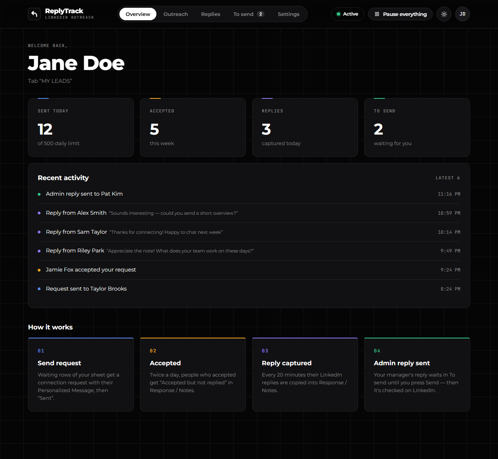
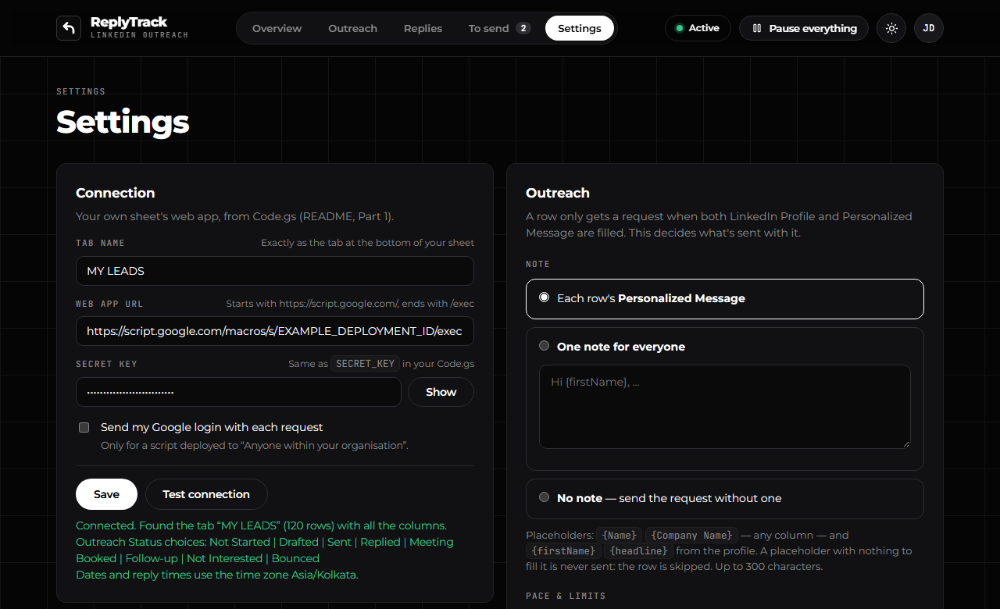
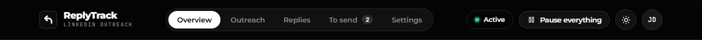
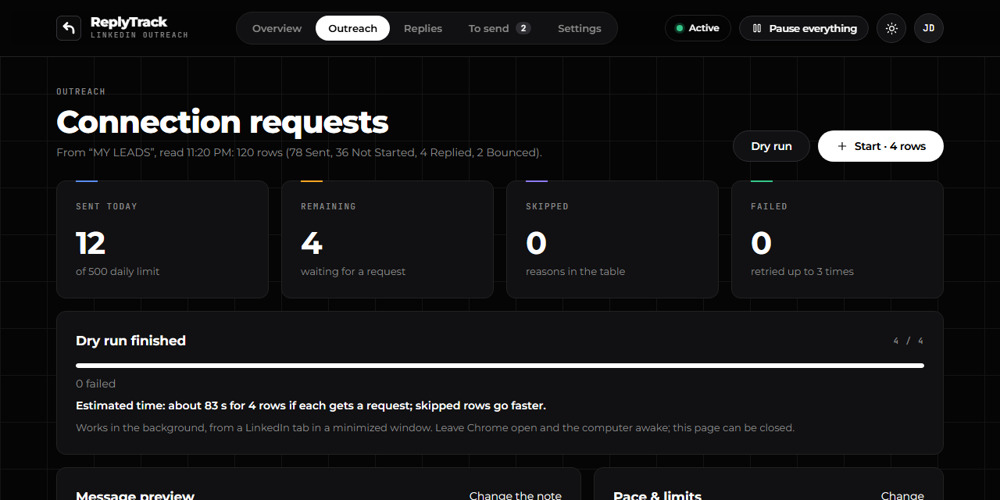
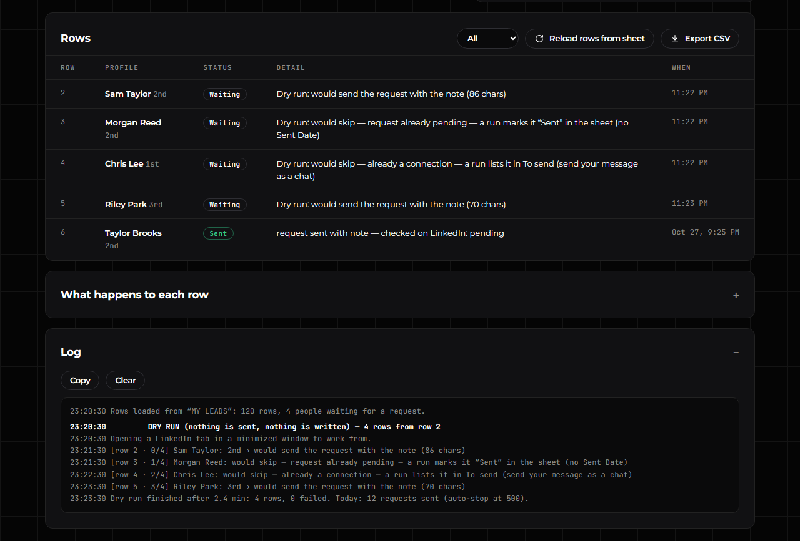
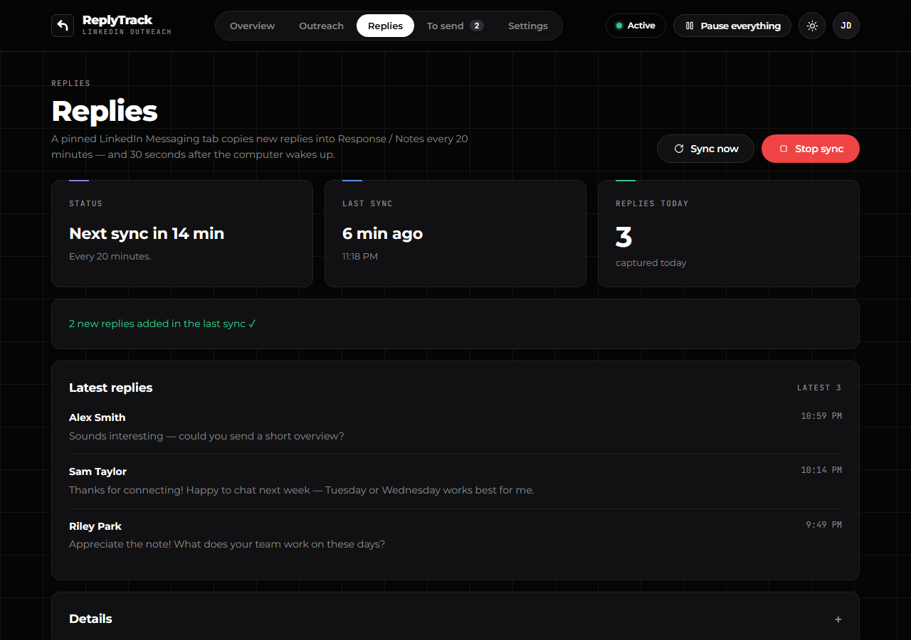
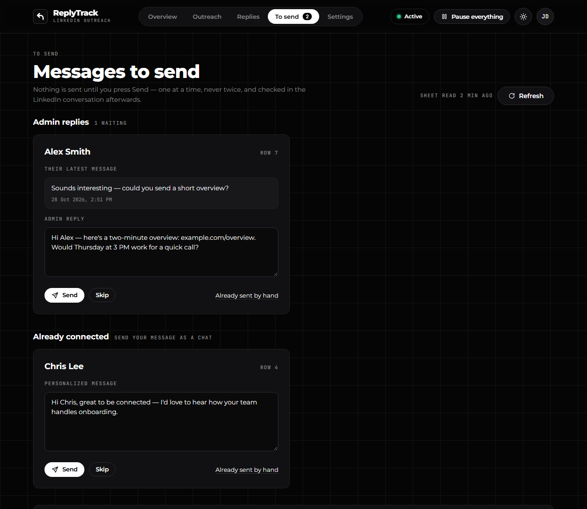
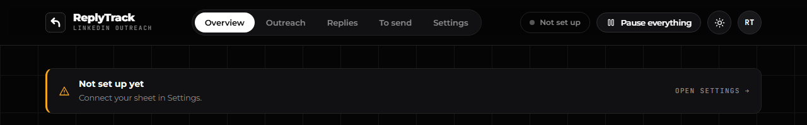

# ReplyTrack

A Chrome add-on that sends your LinkedIn connection requests from your Google Sheet and keeps the sheet up to date for you.

## Contents

- [What ReplyTrack does](#what-replytrack-does)
- [Before you start](#before-you-start)
- [Part 1 — Set up your sheet (once)](#part-1--set-up-your-sheet-once)
- [Part 2 — Install the extension (once)](#part-2--install-the-extension-once)
- [Part 3 — Connect it](#part-3--connect-it)
- [Part 4 — Daily use](#part-4--daily-use)
- [Part 5 — Make it start by itself](#part-5--make-it-start-by-itself)
- [Something's not working?](#somethings-not-working)
- [Updating to a new version](#updating-to-a-new-version)

---

## What ReplyTrack does

- It sends LinkedIn connection requests to the people in your sheet, with each person's Personalized Message, and marks them **Sent**.
- It notices who accepted, and copies their replies into your sheet by itself.
- It lets you send your manager's reply (the **Admin Reply**) from one dashboard — only when you press **Send**.
- Everything happens in your own Chrome, at a slow, human pace.

---

## Before you start

You need:

- A computer with **Google Chrome**.
- Your **LinkedIn** account, signed in in that Chrome.
- **Your own Google Sheet** with the **MY LEADS** tab. Row 1 of that tab must have these column names: **LinkedIn Profile**, **Personalized Message**, **Outreach Status**, **Sent Date**, **Response / Notes**, **Admin Reply**. (Your team's sheet already has them.)
- The link to the **ReplyTrack page on GitHub** — your team lead will send it. (GitHub is a website where the ReplyTrack files are shared.)
- About **15 minutes**.

---

## Part 1 — Set up your sheet (once)

Here you add a small program to your Google Sheet. Google calls it **Apps Script**. ReplyTrack uses it to read and write your sheet.

1. Open your Google Sheet.
2. Click **Extensions → Apps Script**. A new tab opens with a code editor.
   
   If Google says *"Sorry, unable to open the file at this time"*, see [Google says "unable to open the file"](#google-says-sorry-unable-to-open-the-file-at-this-time).
3. Click inside the code, press **Ctrl+A** (Mac: **Cmd+A**), then press **Delete**. The editor is now empty.
4. In another tab, open the ReplyTrack page on GitHub, click the **apps-script** folder, then click **Code.gs**.
5. Click the **Copy raw file** button (two small squares, top right of the code).
   
6. Go back to the Apps Script tab. Click inside the editor and press **Ctrl+V** (Mac: **Cmd+V**).
7. Make up your **secret key**: a password of 16 or more letters and numbers — for example from a password generator. Use only letters, numbers and dashes. Write it down somewhere safe; you'll need it again in Part 3.
   (The secret key is like a password for your sheet: ReplyTrack sends it with every request, and your sheet ignores any request without it. Don't share it.)
8. Near the top of the code, find this line:
   `var SECRET_KEY = 'CHANGE-ME';`
   Replace **CHANGE-ME** with your secret key. Keep the quote marks around it.
   
9. Click the **Save project** icon (💾) at the top of the editor.
10. In the list next to **Debug** at the top, choose **testSetup**.
11. Click **▶ Run**.
12. Google asks for permission (the first time only). Click **Review permissions** and choose your Google account.
13. Click **Advanced**, then **Go to … (unsafe)**, then **Allow**. If you see tick boxes, tick them all first. ("Unsafe" only means Google hasn't checked a script you added yourself.)
    
14. Look at the **Execution log** at the bottom. It should say **Secret key: set**, and the **MY LEADS** line should say **all columns found**. (Other tabs may say "not usable" — that's fine.)
    
    If MY LEADS says **missing column**, fix that column name in row 1 of your sheet, then run **testSetup** again.
15. Click **Deploy → New deployment** (top right). (To **deploy** means to switch the script on so ReplyTrack can reach it.)
16. Click the ⚙️ gear next to **Select type**, then click **Web app**.
17. Set **Execute as** to **Me**.
18. Set **Who has access** to **Anyone**. (This lets ReplyTrack reach your sheet. Your secret key keeps everyone else out.)
    
    If **Anyone** isn't in the list (some company accounts), choose **Anyone within** your company instead, and remember to do Part 3, step 6.
19. Click **Deploy**. If Google asks for permission again, allow it as in steps 12–13.
20. Under **Web app**, click **Copy** to copy the URL. It ends in **/exec**. Paste it somewhere safe — you'll need it in Part 3.
    

✅ **It worked if** the Execution log said *Secret key: set* and you have a web address that ends in **/exec**.

---

## Part 2 — Install the extension (once)

An **extension** is a small add-on for Chrome. You'll load ReplyTrack from a folder on your computer.

1. On the ReplyTrack page on GitHub, click the green **Code** button, then **Download ZIP**.
   
2. Open your **Downloads** folder. Right-click the ZIP file and choose **Extract All…**, then **Extract**. (Mac: double-click the ZIP file.)
3. Move the new folder to a place where it can stay, for example **Documents**. Chrome loads ReplyTrack from this folder every time, so don't delete, move or rename it later.
4. Open Chrome. Type `chrome://extensions` in the address bar and press **Enter**.
5. Turn on **Developer mode** (the switch at the top right). (This lets Chrome load an add-on from a folder instead of the Chrome Web Store.)
   
6. Click **Load unpacked**.
7. Open the ReplyTrack folder, click the folder named **extension** inside it (it contains a file called *manifest.json*), then click **Select Folder**.
   
8. Click the puzzle-piece icon 🧩 at the top right of Chrome, then click the pin 📌 next to **ReplyTrack**.
   
9. Only if you used the old **LinkedIn Automated Reachout** or the old **ReplyTrack** extension: on `chrome://extensions`, switch them **off**. Don't click **Remove** — that would delete their history.

✅ **It worked if** a dark square icon with a white arrow appears at the top right of Chrome, and the ReplyTrack dashboard opens by itself on the **Settings** tab.

> When Chrome starts, it may show a message about developer-mode extensions. Close it with **✕** — don't click **Disable**.

---

## Part 3 — Connect it

1. Click the **ReplyTrack** icon. The dashboard opens.
2. Click **Settings** at the top.
3. In **Tab name**, type **MY LEADS** — exactly as your tab is named.
4. In **Web app URL**, paste the address from Part 1 (it ends in /exec).
5. In **Secret key**, paste your secret key — the same one you put in Code.gs.
6. Only if you chose **Anyone within** your company in Part 1: tick **Send my Google login with each request**.
7. Click **Save**. ReplyTrack saves your settings and tests the connection.
8. Read the message under the buttons. It should be green and start with **Connected**. Lines that start with ⚠ need fixing — see [Test connection shows a problem](#test-connection-shows-a-problem).
9. Only if you used the old **LinkedIn Automated Reachout** extension: scroll down to **Data → Import sent history** and follow the steps shown there, so nobody gets a second request.

You can click **Test connection** any time to check again. Leave the **Outreach** card on the right as it is unless your team lead says otherwise.

✅ **It worked if** the message says *Connected*, the pill at the top turns green and says **Active**, and a small pinned **LinkedIn Messaging** tab appears at the far left of your Chrome tabs.

---

## Part 4 — Daily use

Click the **ReplyTrack** icon to open the dashboard. The tabs at the top: **Overview** (today at a glance), **Outreach**, **Replies**, **To send** and **Settings**.

### Outreach — send connection requests

ReplyTrack only sends to rows where **Outreach Status** is empty or **Not Started** and both **LinkedIn Profile** and **Personalized Message** are filled in. It never touches rows with any other status, and never sends a second request to the same person.

1. Click **Outreach**.
2. Click **Dry run** first. It checks each waiting row on LinkedIn and tells you what would happen. It sends nothing and doesn't change your sheet.
   
3. Scroll down to the **Rows** table and read what would happen to each row. Click **Log** to see more details.
   
4. Click **Start**. (The button shows how many rows are waiting.)
5. Click **OK** to confirm.
6. Leave it running. It works in a small minimized LinkedIn window, so you can close the dashboard. Keep Chrome open.
7. To stop it, click the red **Stop** button. Next time the button says **Continue from row …**.

✅ **It worked if** the card says *Sending 1 of …* and, in your sheet, the rows change to **Sent** with today's **Sent Date**.

Good to know:

- After **500** requests in a day it stops by itself, and a banner says *Daily invite limit reached — press Continue tomorrow*.
- People you're already connected with don't get a request. They appear in **To send → Already connected**, so you can send them your message as a chat.
- Twice a day ReplyTrack checks who accepted, and writes **Accepted but not replied** in their **Response / Notes**. To check right now, click **Check now** in the **Who accepted** card.

### Replies — automatic

Every 20 minutes, the pinned **LinkedIn Messaging** tab copies new replies into **Response / Notes**, with the date and time. The person's **Outreach Status** changes from **Sent** to **Replied**. Leave that pinned tab open.

1. To check for replies right now, click **Replies**, then **Sync now**.
2. To stop only the replies, click **Stop sync**. To turn them back on, click **Start sync**.

✅ **It worked if** new replies appear under **Latest replies** and in your sheet.

### To send — send replies yourself

Nothing here is sent until you press **Send**. There are two kinds of items:

- **Admin replies** — a reply your manager wrote for you in the main sheet.
- **Already connected** — people you're already connected with; you can send them your Personalized Message as a chat.

The number on the ReplyTrack icon shows how many are waiting.

1. Click **To send**.
2. Read their latest message.
3. Change the text in the box if you want to.
4. Click **Send**.
5. Click **OK** when it asks *Send this message to …?*
6. Wait a few seconds. ReplyTrack checks that you're connected, sends the message once, and checks that it arrived.

✅ **It worked if** the item disappears. For an admin reply, the **Admin Reply** and **Response / Notes** cells in that row are emptied. For an "Already connected" item, the row gets **Sent** and today's **Sent Date**.

The other buttons:

- **Skip** — hide this item. It comes back only if the text changes.
- **Already sent by hand** — you already sent it yourself on LinkedIn. Nothing is sent; the row is updated as if it had been sent.

If you see one of these messages:

- **Not connected yet — LinkedIn only allows messages to connections** — they haven't accepted yet. **Send** stays grey.
- **This message is already in the conversation** — click **Mark as sent**.
- **Couldn't confirm — check the conversation on LinkedIn** — click **Open the conversation** and look. Then click **It was sent** or **It wasn't sent**. ReplyTrack never sends a message twice by itself.
- **You already sent this exact message to …** — the same text can't be sent twice to the same person.

### Pause everything

Click **Pause everything** (top right) to stop outreach, replies and the "who accepted" check in one click. The pill turns grey and says **Paused**. Click **Start again** to turn back on what was running.

The pill at the top tells you how things are:

- 🟢 **Active** — everything is on.
- 🟠 **Partly paused** — the replies are stopped, or outreach stopped part-way. Hold the mouse over the pill to see which.
- ⚪ **Paused** — you pressed **Pause everything**.

---

## Part 5 — Make it start by itself

ReplyTrack only works while Chrome is open. Set Chrome to open when your computer starts.

#### Windows

1. Press the **Windows key + R**, type `shell:startup` and press **Enter**. A folder opens.
2. Find **Google Chrome** in the Start menu, right-click it and choose **Open file location**.
3. Right-click **Google Chrome** and choose **Copy**.
4. Go back to the startup folder, right-click an empty spot and choose **Paste shortcut**.

#### Mac

1. Click the Apple menu → **System Settings → General → Login Items**.
2. Under **Open at Login**, click **+**, choose **Google Chrome** and click **Open**.

#### In Chrome (Windows and Mac)

1. Click Chrome's menu **⋮** → **Settings → On startup** → choose **Continue where you left off**. This brings the pinned LinkedIn tab back.
2. Windows only: in **Settings → System**, turn on **Continue running background apps when Google Chrome is closed**.

#### Every day

- Keep the pinned **LinkedIn Messaging** tab open. If you close it, it comes back within 20 minutes.
- Keep the computer on during work hours. The screen may turn off and you may lock the computer — only **sleep** stops ReplyTrack.

✅ **It worked if**, after you restart your computer, Chrome opens by itself with the pinned LinkedIn tab, and the ReplyTrack pill says **Active**.

---

## Something's not working?

### The pill says "Not set up"

ReplyTrack doesn't have your settings yet. Click **Open settings** on the banner and do [Part 3](#part-3--connect-it).

### "LinkedIn logged out — sign in again"

1. Click **Sign in** on the banner. LinkedIn's sign-in page opens.
2. Sign in to LinkedIn.

The banner goes away once you're signed in. If outreach had stopped, open **Outreach** and click **Continue from row …**.

### Test connection shows a problem

| The message says | What to do |
|---|---|
| Your sheet has no tab called "…" | Check **Tab name** in Settings. It must match your tab exactly — spaces count. |
| The secret key doesn't match SECRET_KEY in your Code.gs | Paste the same key in Settings and in Code.gs. If you changed it in Code.gs after deploying, deploy again ([Updating](#updating-to-a-new-version), steps 9–11). |
| Your Code.gs isn't ready: set SECRET_KEY in Code.gs | You didn't replace **CHANGE-ME** yet. Do Part 1, step 8, save, then deploy again ([Updating](#updating-to-a-new-version), steps 9–11). |
| … SECRET_KEY in Code.gs is too short | Use a key with 16 or more characters. |
| Problem: missing column: … | Row 1 of your MY LEADS tab is missing that column name. Add it exactly as written. |
| Problem: Apps Script returned a web page instead of an answer | In the deployment, **Who has access** must be **Anyone**, and the address must end in **/exec**. |
| That's a test (/dev) URL | Use the address from **Deploy** that ends in **/exec**. |
| Problem: could not reach Apps Script | Check your internet connection and try again. |
| Problem: unexpected answer … is the NEW Code.gs deployed? | Your sheet still has an old script. Paste the new Code.gs and deploy again ([Updating](#updating-to-a-new-version), steps 6–11). |
| ⚠ "Sent" isn't in the dropdown | Ask your team lead to add **Sent** (and **Replied**) to the Outreach Status dropdown. |

If a banner says **Can't reach your sheet — check settings**, check your internet, then click **Test connection** in Settings.

### Replies don't appear in my sheet

Check these, in order:

1. Open the **Replies** tab. If it says **Stopped**, click **Start sync**. If it says **Paused**, click **Start again** at the top.
2. Make sure the pinned **LinkedIn Messaging** tab is open. Clicking **Sync now** opens it again.
3. The person must be in your **MY LEADS** tab with the same LinkedIn Profile link. Replies from people who aren't in your sheet are not written.
4. Group chats, sponsored messages and InMail are skipped.
5. While outreach is running, replies wait and sync right after it finishes.

### Google says "Sorry, unable to open the file at this time"

This happens when Chrome is signed in to several Google accounts at once.

1. Open an Incognito window: press **Ctrl+Shift+N** (Mac: **Cmd+Shift+N**).
2. Go to **sheets.google.com** and sign in with only the Google account that owns your sheet.
3. Open your sheet, then click **Extensions → Apps Script** and continue with Part 1.

You only need Incognito for setting up the script. Use ReplyTrack in your normal Chrome window.

---

## Updating to a new version

1. Download the new ZIP from GitHub and extract it (Part 2, steps 1–2).
2. Open your **existing** ReplyTrack folder — the one you loaded in Part 2 — and replace everything in it with the files from the new folder. Keep the folder in the same place, with the same name. (If it moves, Chrome treats it as a new extension and your settings and history are lost.)
3. Go to `chrome://extensions`.
4. On **ReplyTrack**, click the **↻** reload icon.
   

Your settings and history are kept. Never click **Remove** on ReplyTrack — that deletes its history (for example, who already got a request).

Only if the update notes say **Code.gs changed**:

5. Open your sheet and click **Extensions → Apps Script**.
6. Replace all the code with the new Code.gs (Part 1, steps 3–6).
7. Put your secret key back into the `SECRET_KEY` line — the same key as before (Part 1, step 8).
8. Click **Save project** (💾).
9. Click **Deploy → Manage deployments**.
10. Click the ✏️ pencil, and under **Version** choose **New version**.
11. Click **Deploy**.
    

Your web app address stays the same, so you don't need to change anything in Settings.

✅ **It worked if** the pill says **Active** and **Settings → Test connection** says *Connected*.

---

*For developers: how ReplyTrack works inside, the sheet rules, storage and the test checklist are in [DEVELOPER.md](DEVELOPER.md).*
